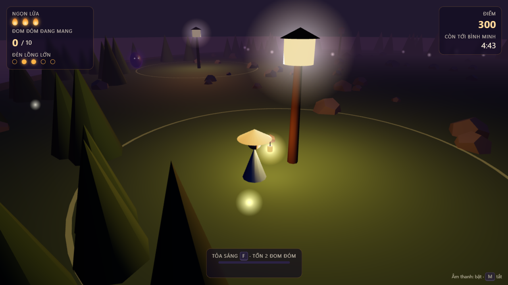

# Đảo Đèn Lồng

> **Video demo:** sẽ cập nhật ở Phase 4 (Release `v1.0.0`).
> Day 12 AI SDLC Lab · Thân Đức Trung · 2A202603449 · Tài liệu lab gốc: [docs/lab/](docs/lab/README.md) · Kế hoạch: [PLAN.md](PLAN.md)

Game 3D góc nhìn thứ ba. **Mây**, người giữ đèn nhỏ tuổi đội nón lá treo một chiếc đèn lồng nhỏ, chạy khắp **Đảo Bến** gom đom đóm để thắp lại **5 Đèn Lồng Lớn** trước bình minh. Mây phải né **Bóng Mực** trong sương đen, hoặc tỏa sáng để xua chúng đi.



## Cài đặt và chạy (3 lệnh)

Cần Node.js ≥ 22. Chạy được trên macOS, Linux và Windows.

```bash
git clone https://github.com/DucTrung611/K5-L3A-DAY12-ThanDucTrung-2A202603449-AI-SDLC-Dao-Den-Long.git && cd K5-L3A-DAY12-ThanDucTrung-2A202603449-AI-SDLC-Dao-Den-Long
npm ci
npm run dev        # mở http://localhost:5173
```

Bản web tĩnh: `npm run build` sinh thư mục `dist/` (chạy bằng `npm run preview` hoặc bất kỳ web server tĩnh nào).

## Điều khiển

| Phím | Hành động |
|---|---|
| `W` `A` `S` `D` / `↑` `↓` | Đi lại theo hướng camera |
| `←` `→` / kéo chuột | Xoay camera |
| `Space` | Nhảy |
| `E` | Nạp đom đóm đang mang vào Đèn Lồng chưa thắp gần nhất (trong 3 m) |
| `F` | Tỏa sáng: xua Bóng Mực trong 6 m (tốn 2 đom đóm, hồi chiêu 1 s) |
| `Enter` / `R` | Bắt đầu / Chơi lại sau khi thắng hoặc thua |
| `M` | Bật/tắt âm thanh |

## Luật chơi và cách tính điểm

- Đi gần đom đóm (≤ 1.5 m) thì tự nhặt. Mang tối đa **10** con.
- Mỗi Đèn Lồng cần **5** đom đóm để thắp. Nhấn `E` trong bán kính 3 m để nạp, có thể nạp nhiều lần.
- **Bóng Mực** xuất hiện từ giây 10, cứ 15 s thêm một con (tối đa 6), đuổi theo Mây với tốc độ 3.5 m/s (Mây chạy 6 m/s). Bị chạm (≤ 1 m) thì mất 1 **Ngọn Lửa**, đánh rơi một nửa số đom đóm đang mang (làm tròn xuống), rồi bất tử 1.5 s.
- **Tỏa sáng** làm choáng 2.5 s và đẩy lùi 4 m mọi Bóng Mực trong 6 m.
- **Bóng Mực sợ đèn**: chúng không vào được vòng 8 m quanh đèn **đã thắp**.
- **Thắng**: thắp đủ 5 đèn. **Thua**: hết 3 Ngọn Lửa, hoặc hết 300 s mà đèn chưa sáng hết.

| Sự kiện | Điểm |
|---|---|
| Nhặt 1 đom đóm | +10 |
| Thắp 1 đèn | +100 |
| Mỗi Bóng Mực bị choáng | +20 |
| Khi thắng: mỗi giây còn lại (làm tròn xuống) | +2 |
| Khi thắng: mỗi Ngọn Lửa còn lại | +50 |

## Chế độ headless (Test Contract v1.0)

Khai báo ở [game.contract.json](game.contract.json). Logic chạy 60 tick/giây cố định, không cần cửa sổ hay GPU.

```bash
node src/headless/cli.js --seed 1 --night 1 --ticks 3600 --out out/run.jsonl \
  [--scenario tests/scenarios/deposit_and_light/scenario.json] [--inputs file.json] [--snapshot-every 10]
```

Mã thoát: `0` thành công · `1` sai tham số hoặc lỗi chạy · `2` file scenario/inputs sai định dạng (kể cả `move` ngoài [-1,1], `tick` không tăng nghiêm ngặt, id đèn lạ). Lỗi luôn in ra stderr.

**Giá trị null/false và khái niệm không dùng:**
- `fall_enabled: false`: đảo có biên tròn bán kính 40 m chặn người chơi, nên không thể rơi và không bao giờ phát `player_hit` với `by: "fall"`.
- `dash`: không có trong game. Trường này được chấp nhận trong inputs nhưng bị bỏ qua.
- Không khóa tuning nào là `null`. Các số nội bộ không có khóa trong contract (biên đảo 40 m, nhịp sinh Bóng Mực và đom đóm, nhảy) nằm trong `WORLD` ở [src/sim/tuning.js](src/sim/tuning.js) và được giải thích trong [docs/notes/phase-1.md](docs/notes/phase-1.md).

## Kiểm thử

```bash
npm run verify      # contract + 28 unit test + 26 scenario headless + determinism + bot chơi tới thắng
npm run proof -- --phase 1   # chạy lại toàn bộ và lưu bằng chứng vào docs/proof/phase-1/
```

- Bằng chứng Phase 1: [docs/proof/phase-1/report.md](docs/proof/phase-1/report.md) (bảng yêu cầu → bằng chứng) và [results.md](docs/proof/phase-1/results.md) (kết quả tự sinh).
- CI: [.github/workflows/ci.yml](.github/workflows/ci.yml) chạy `npm run verify` trên Ubuntu và macOS mỗi lần push.

## Sáng tạo của tôi

Toàn bộ phần thêm nằm trong [src/client/extras/](src/client/extras/), **chỉ đọc** trạng thái mô phỏng và chỉ chạy ở client có giao diện. Headless không import các file này.

1. **Đảo sáng dần** ([ambience.js](src/client/extras/ambience.js)): mỗi đèn được thắp làm sương tan bớt, bầu trời và ánh sáng chuyển dần sang tông ấm. So sánh [ảnh lúc 2 đèn](docs/proof/phase-1/02-gameplay-hud.png) với [ảnh khi đủ 5 đèn](docs/proof/phase-1/05-island-all-lit.png).
2. **Âm thanh tổng hợp bằng WebAudio** ([audio.js](src/client/extras/audio.js)): mỗi sự kiện (nhặt, nạp, thắp, tỏa sáng, bị chạm, thắng, thua) có một âm riêng. Không dùng file âm thanh ngoài.

Bằng chứng phần lõi vẫn đúng sau khi thêm: `npm run verify` vẫn xanh. Unit test `src/sim không dùng nguồn bất định và không import render` cấm `src/sim` phụ thuộc client. Khi phát lại cùng một file inputs, client ra đúng kết quả của headless (seed 1: thắng ở tick 2405 với 1458 điểm, xem [report](docs/proof/phase-1/report.md)).

## Cấu trúc

```text
src/sim/         lõi mô phỏng thuần (dùng chung headless + client)
src/headless/    CLI theo Test Contract
src/client/      Three.js, HUD, input; extras/ = sáng tạo
tests/unit/      unit test (node:test)
tests/scenarios/ scenario headless + expect.json tính tay
scripts/         runner scenario, determinism, contract, bot, proof, hooks
docs/notes/      giả định, nhật ký AI, đánh giá từng phase, retro
docs/proof/      bằng chứng từng phase
AGENTS.md, CLAUDE.md, .claude/   harness AI (hooks, skill verify-game, subagent reviewer)
```

Giấy phép: [MIT](LICENSE) · Ghi nguồn: [CREDITS.md](CREDITS.md) · Lịch sử: [CHANGELOG.md](CHANGELOG.md)
