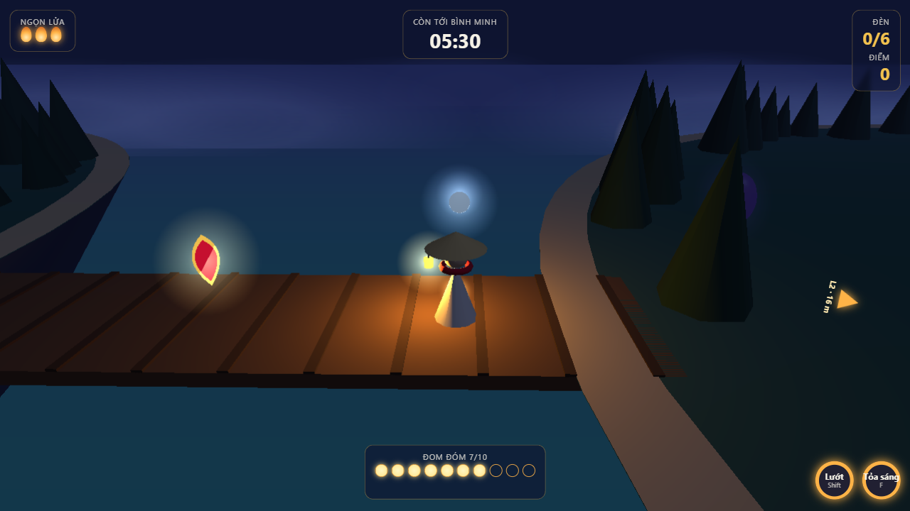
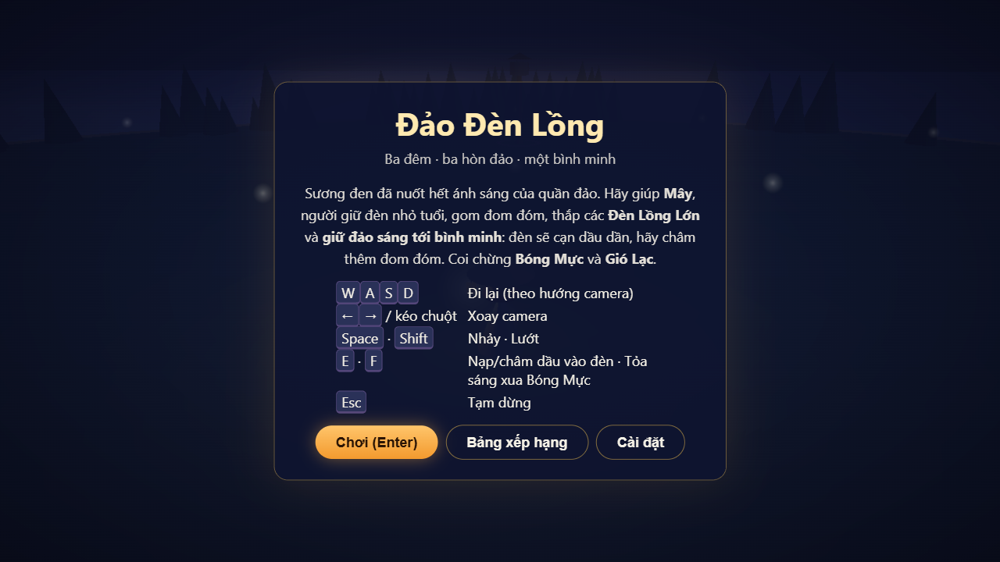

# Đảo Đèn Lồng

> **Video demo:** [demo.mp4 trong Release v1.0.0](https://github.com/DucTrung611/K5-L3A-DAY12-ThanDucTrung-2A202603449-AI-SDLC-Dao-Den-Long/releases/tag/v1.0.0) (nếu chưa mở được: `docs/demo/demo.mp4`).
> Day 12 AI SDLC Lab · Thân Đức Trung · 2A202603449 · Tài liệu lab gốc: [docs/lab/](docs/lab/README.md) · Kế hoạch: [PLAN.md](PLAN.md) · Trạng thái: **Phase 4 (Ticket-04 "Bình minh", Contract v1.3) · phát hành v1.0.0**

Game 3D góc nhìn thứ ba. **Mây**, người giữ đèn nhỏ tuổi đội nón lá treo một chiếc đèn lồng nhỏ, đi qua **ba hòn đảo** trong ba đêm, gom đom đóm để thắp lại các **Đèn Lồng Lớn**, né **Bóng Mực** và **Gió Lạc** trước khi trời sáng.





**Yêu cầu hệ thống:** Node.js ≥ 22; trình duyệt có WebGL (Chrome/Edge/Firefox/Safari mới); GPU rời hoặc iGPU đủ để đạt ~60 FPS ở 1280×720 (máy phát triển: AMD Radeon iGPU, ~95–130 FPS ở cảnh benchmark). Benchmark cần thêm Chrome hoặc Edge.

## Cài đặt và chạy (3 lệnh)

Cần Node.js ≥ 22. Chạy được trên macOS, Linux và Windows.

```bash
git clone https://github.com/DucTrung611/K5-L3A-DAY12-ThanDucTrung-2A202603449-AI-SDLC-Dao-Den-Long.git && cd K5-L3A-DAY12-ThanDucTrung-2A202603449-AI-SDLC-Dao-Den-Long
npm ci
npm run dev        # mở http://localhost:5173
```

Bản web tĩnh: `npm run build` sinh `dist/` (chạy bằng `npm run preview` hoặc web server tĩnh bất kỳ).

## Điều khiển

Phím mặc định (đổi được trong **Cài đặt → Đổi phím**, có phát hiện trùng phím và nút Khôi phục mặc định; cấu hình được lưu):

| Phím | Hành động |
|---|---|
| `W` `A` `S` `D` (và `↑` `↓`) | Đi lại theo hướng camera |
| `←` `→` / kéo chuột | Xoay camera (cố định, không đổi được) |
| `Space` | Nhảy |
| `Shift` | **Lướt** 14 m/s trong 0.2 s, hồi chiêu 1.5 s, giữ nguyên độ cao |
| `E` | Nạp đom đóm vào Đèn Lồng chưa sáng / châm dầu đèn đang sáng, gần nhất trong 2 m |
| `F` | Tỏa sáng: xua Bóng Mực trong 5 m (tốn 3 đom đóm, hồi chiêu 3 s) |
| `Esc` | Tạm dừng (logic dừng hẳn): Tiếp tục / Chơi lại Đêm / Cài đặt / Về menu |
| `Enter` / `R` | Bắt đầu, sang màn kế / Chơi lại Đêm sau khi thua |

**Cài đặt** (âm lượng, độ nhạy chuột, bảng màu dễ phân biệt, **giảm chuyển động**, **chữ lớn ×1.25**, **phụ đề/chỉ báo**, đổi phím) được lưu và giữ nguyên ở lần mở game sau.

**Dễ tiếp cận (Phase 4):** đổi phím cho mọi hành động; phụ đề và chỉ báo hình ảnh cho Bóng Mực xuất hiện (kèm mũi tên chỉ hướng ở mép màn hình), Gió sắp thổi, 10 giây cuối, đèn `fuel < 30`; Giảm chuyển động (tắt rung camera, chớp màn hình, nhấp nháy); cỡ chữ mặc định ≥ 18 px ở 1280×720, Chữ lớn ×1.25.

**Bảng xếp hạng cục bộ (Phase 4):** Menu → *Bảng xếp hạng*. Sau khi thua ở bất kỳ Đêm nào hoặc ở màn Bình Minh, nhập tên 3–12 ký tự (`A-Z a-z 0-9 _`) để lưu điểm. Giữ top 10 (điểm giảm dần, bằng điểm thì ai đạt trước đứng trên), lưu bền ở `data/leaderboard.json` khi chạy bằng `npm run dev`/`npm run preview` (bản web tĩnh không có máy chủ thì lưu trong trình duyệt). Xuất ra file: `node scripts/run.js --export-leaderboard out.json`.

## Luật chơi (số chuẩn của Ticket-02)

- Đi gần đom đóm (XZ ≤ 1.0 m **và** chênh cao so với mặt đất nơi đặt ≤ 1.5 m) thì tự nhặt. Mang tối đa **10**. Mỗi đêm bắt đầu với 20 đom đóm, cứ 4 s sinh thêm 1 (trần 30).
- Mỗi Đèn Lồng cần **10** đom đóm; nhấn `E` trong 2 m, nạp nhiều lần được, đèn nhớ tiến độ.
- Đèn **đã sáng** tạo vùng an toàn bán kính **6 m**: Bóng Mực không vào được (con đang ở trong thì bị đẩy ra trong 30 tick, không gây sát thương).
- **Bóng Mực** (4.0 m/s, Đêm 3: 4.5): phát hiện trong 12 m, bỏ đuổi khi xa hơn 18 m. 2 con xuất hiện ở giây 5, rồi 1 con mỗi 8 / 7 / 6 s (Đêm 1/2/3), tối đa 6 / 8 / 10. Chạm (≤ 1.0 m) → mất 1 **Ngọn Lửa**, rơi một nửa đom đóm đang mang quanh Mây, bất tử 1.5 s, Bóng Mực lùi 2 m.
- **Tỏa sáng** làm choáng 2 s và đẩy lùi 4 m mọi Bóng Mực trong 5 m.
- **Rơi khỏi đảo** (Y < −10): mất 1 Ngọn Lửa và toàn bộ đom đóm, chờ 1 s rồi hồi sinh ở điểm xuất phát, bất tử 1.5 s.
- Mỗi đêm có 3 Ngọn Lửa. **Thắng**: thắp hết đèn (kể cả đúng lúc hết giờ). **Thua**: hết Ngọn Lửa, hoặc hết giờ (300 / 330 / 360 s) mà đèn chưa sáng hết. Thua thì chơi lại đúng đêm đó.

| Đêm | Đảo | Đèn | Đặc điểm |
|---|---|---|---|
| 1 | **Đảo Bến**: đảo tròn bán kính 40 m | 5 | Làm quen |
| 2 | **Đảo Cầu**: hai đảo bán kính 28 m nối bằng cầu tre không lan can | 6 | 2 **bục nhảy** phóng sang đảo kia, **Gió Lạc**, **Bùa Gió** giữa cầu |
| 3 | **Đảo Chuông**: 3 tầng, vách đứng, 2 dốc 30°, bục nhảy, tháp chuông | 7 | **Gió mạnh** (5 s mỗi 30 s, báo trước 2 s bằng lá bay), 2 Bùa Gió |

**Gió Lạc** (Đêm 2, 3): dải lụa xám xanh bay 7 m/s. Khi Mây mang ≥ 5 đom đóm trong 15 m nó lao tới, chạm thì cướp 3 đom đóm rồi bỏ chạy. Tỏa sáng khi nó đang lao tới → nó bỏ chạy không cướp được; khi nó đang chạy mang đồ → nó làm rơi lại đồ.
**Bùa Gió**: lá bùa đỏ viền vàng, 10 s chạy 7.2 m/s và lướt không hồi chiêu, xuất hiện lại sau 45 s.

**Đèn cạn dầu (Phase 3)**: mục tiêu là **giữ đảo sáng tới bình minh**. Đèn thắp xong có dầu 100, hao 1/giây; bấm **E** ở đèn đang sáng để châm dầu (mỗi đom đóm +10, đèn đầy dầu thì không chọn). Hết dầu thì đèn tắt, thắp lại chỉ cần 5 đom đóm (đèn chưa từng sáng cần 10). Đèn dưới 30 dầu **mất vùng an toàn** và nhấp nháy; **Bóng Mực** đang lang thang sẽ tìm tới đèn yếu nhất, đứng hút 5 dầu/giây (cộng dồn). Thắng khi hết giờ còn sống và có ≥ 60% số đèn đang sáng (3/5, 4/6, 5/7); đêm dài 240/270/300 s. Sức chứa đom đóm tăng 2 mỗi lần thắp thành công (tối đa 20, đặt lại mỗi đêm). Cài đặt có **Bảng màu dễ phân biệt**.

**Điểm (Phase 3)**: +5 mỗi đom đóm nạp (thắp, thắp lại, châm dầu) · thắp lần đầu +100 · thắp lại +40 · Bóng Mực trúng Tỏa sáng +5 (+15 nếu đang hút dầu) · khi thắng, mỗi đèn sáng `+50 + floor(dầu)` và mỗi Ngọn Lửa còn lại +50. Không còn thưởng thời gian. Tổng điểm là tổng các đêm đã thắng.

## Chế độ headless (Test Contract v1.3)

Khai báo ở [game.contract.json](game.contract.json). Logic chạy 60 tick/giây cố định, không cần cửa sổ hay GPU. Một đêm đầy đủ (tối đa 21 600 tick) chạy trong dưới 1 giây.

```bash
node src/headless/cli.js --seed 1 --night 1|2|3 --ticks 3600 --out out/run.jsonl \
  [--scenario tests/scenarios/deposit_and_light/scenario.json] [--inputs file.json] [--snapshot-every 10]
```

Mã thoát: `0` thành công · `1` sai tham số hoặc lỗi chạy (kể cả `--night` ngoài 1..3) · `2` file scenario/inputs sai định dạng (JSON hỏng, `move` ngoài [-1,1], `tick` không tăng nghiêm ngặt, id đèn không thuộc đêm đó, `state` lạ...). Lỗi luôn in ra stderr.

Phase 3 (v1.2) thêm: snapshot đèn `fuel` (1 chữ số), `ever_lit`, `relit_count`, `player.capacity`, Bóng Mực `state: "drain"`; event `refuel`, `lantern_out`, `fuel_drain` (mỗi 60 tick), `lantern_lit.relight`, `game_over.reason` `dawn_survived`; scenario `lanterns[].{fuel,ever_lit}`, `player.successful_lights`, `shades[].target_lantern_id`. Giả định B31…B48 ở [docs/notes/phase-3.md](docs/notes/phase-3.md); quyết định thiết kế ở [docs/adr-phase-3.md](docs/adr-phase-3.md).

Có thêm so với v1.0: input `dash`, `pause`; scenario `player.{invuln_ticks,dash_cd_ticks,pulse_cd_ticks,charm_ticks}`, `shades[].{state,state_ticks_left}`, `drifters`, `charms`, `random_drifters`, `wind_enabled`; snapshot `night`, `wind`, `player.{vel,grounded,invuln,dash_cd_s,pulse_cd_s,charm_s}`, `motes[kind,ttl_s]`, `drifters`, `charms`; event `dash`, `charm_picked`, `drifter_steal`, `drifter_drop`, `night_start`, `paused`, `resumed`.

**Giá trị đặc biệt trong contract:** `fall_enabled: true` (rơi khỏi đảo có phạt). Không khóa tuning nào là `null`. Điểm xuất phát Đêm 3 là **(0,0,−20)** (ticket không nêu; (0,0,0) nằm trong tháp chuông). `shade_speed` khai 4.0, riêng Đêm 3 là 4.5 (số nội bộ `RULES.shade_speed_night3`). Toàn bộ giả định B1…B30 ở [docs/notes/phase-2.md](docs/notes/phase-2.md).

Contract v1.3 (Phase 4) **không đổi luật, tuning hay schema JSONL**; chỉ thêm `bench_cmd`, `soak_cmd` và `run_cmd` = `node scripts/run.js`. Cả `run_cmd` lẫn `headless_cmd` hiểu `--export-leaderboard out.json`.

## Benchmark và soak test (Phase 4)

```bash
node scripts/bench.js --seed 42 --duration 30 --out bench.json   # = npm run bench
node scripts/soak.js  --seed 7  --nights 10 --out soak.json      # = npm run soak
```

- **Benchmark** mở Chrome/Edge (qua Playwright, tự build `dist/` nếu chưa có), cửa sổ 1280×720 không toàn màn hình, tắt VSync bằng cờ Chrome `--disable-frame-rate-limit --disable-gpu-vsync` (`vsync_off: true`), tải Đêm 1 đầy đủ ánh sáng với 200 Bóng Mực `wander` + 100 đom đóm + L1–L3 sáng `fuel = 100`, Mây đứng yên ở gốc, camera bay vòng r = 30 m, Y = 15 m, 15 s/vòng ngược chiều kim đồng hồ. Bỏ 3 s khởi động, đo `--duration` giây rồi thoát mã 0. Máy không có màn hình: `BENCH_HEADLESS=1`; chọn trình duyệt: `BENCH_BROWSER=<đường dẫn exe>`. Mọi nhân vật/hiệu ứng sáng tạo thêm (vệt sáng theo chân Mây) bị tắt trong cảnh này. Giả định B49–B54 ở [docs/notes/phase-4.md](docs/notes/phase-4.md).
- **Soak** chạy 10 Đêm liên tiếp (xoay vòng 1→2→3, seed `7 + i`) trong cùng một tiến trình Node với input ngẫu nhiên theo seed, đo RSS đầu/cuối (sau khi ép GC). Đạt khi `crashes == 0` và `mem_end_mb <= 1.2 × mem_start_mb`.
- Kết quả đã chạy của tôi (commit sẵn ở gốc repo): [bench.json](bench.json) (Chrome 158, AMD Radeon iGPU, Windows 11: 96.4 FPS trung bình, p1-low 56.6 FPS, p95 12.3 ms, load 2.7 s; các lần chạy khác nhau dao động ~95–130 FPS) và [soak.json](soak.json) (10 đêm, 0 sập, RSS 57.7 → 57.7 MB). Số trên máy chấm chuẩn có thể khác.

## Kiểm thử

```bash
npm test            # unit test (node:test), ~3 s
npm run verify      # contract v1.3 + unit test + 102 scenario headless + determinism 3 đêm + bot Đêm 1 + soak 10 đêm
npm run ui-check    # kiểm giao diện bằng trình duyệt thật: đổi phím, cỡ chữ, phụ đề, bảng xếp hạng (cần Chrome/Edge)
npm run mutation    # sửa cố ý hằng số/logic, scenario phải FAIL (test không phải loại luôn đạt)
npm run proof -- --phase 4   # chạy lại toàn bộ (gồm bench, soak, ui-check) và lưu bằng chứng vào docs/proof/phase-4/
```

- Bằng chứng Phase 4: [docs/proof/phase-4/results.md](docs/proof/phase-4/results.md) (tự sinh), giả định và truy vết ở [docs/notes/phase-4.md](docs/notes/phase-4.md). Phase 3: [docs/proof/phase-3/report.md](docs/proof/phase-3/report.md) và [results.md](docs/proof/phase-3/results.md) (tự sinh). Phase 2: [docs/proof/phase-2/report.md](docs/proof/phase-2/report.md). Phase 1: [docs/proof/phase-1/](docs/proof/phase-1/report.md).
- Mọi `expect.json` được tính **tay** từ ticket (công thức trong [tests/scenarios/_generate.mjs](tests/scenarios/_generate.mjs)), không chép từ output chương trình.
- CI: [.github/workflows/ci.yml](.github/workflows/ci.yml) chạy `npm run verify` trên Ubuntu và macOS mỗi lần push.

## Sáng tạo của tôi

Phần thêm chỉ nằm ở client (`src/client/`), **chỉ đọc** trạng thái mô phỏng; headless không import chúng.

1. **Vệt sáng theo chân Mây** ([scene.js](src/client/scene.js)): 14 đốm sáng mờ dần phía sau; sáng hơn khi đang có Bùa Gió.
2. **Nhạc nền và âm thanh tự tổng hợp bằng WebAudio** ([audio.js](src/client/audio.js)): pad hợp âm La thứ làm nền đêm, mỗi sự kiện có một âm riêng. Không dùng file âm thanh ngoài.
3. **Đom đóm rơi và vùng an toàn có hiệu ứng**: đom đóm rơi nhấp nháy khi sắp hết TTL; mép vùng an toàn của đèn sáng hiện một vòng sáng trên mặt đất.

Bằng chứng phần lõi vẫn đúng: `npm run verify` xanh; unit test `src/sim không dùng nguồn bất định và không import render`; client và headless cho cùng kết quả với cùng input (xem [report](docs/proof/phase-2/report.md)).

## Cấu trúc

```text
src/sim/         lõi mô phỏng thuần (số chuẩn, bản đồ, một tick); dùng chung headless + client
src/headless/    CLI theo Test Contract (+ --export-leaderboard)
src/client/      Three.js, HUD, menu, input, audio, cài đặt
tests/unit/      unit test (node:test)
tests/scenarios/ 66 scenario headless + expect.json tính tay (+ _generate.mjs)
scripts/         runner scenario, determinism, contract, bot, mutation, proof, hooks, bench, soak, run, ui-check
docs/notes/      giả định, nhật ký AI, đánh giá từng phase, retro
docs/proof/      bằng chứng từng phase (ảnh, JSONL, FPS, mutation)
AGENTS.md, CLAUDE.md, .claude/   harness AI (hooks, skill verify-game, subagent reviewer)
```

Retro: [docs/notes/retro.md](docs/notes/retro.md) · Giấy phép: [MIT](LICENSE) · Ghi nguồn: [CREDITS.md](CREDITS.md) · Lịch sử: [CHANGELOG.md](CHANGELOG.md)
